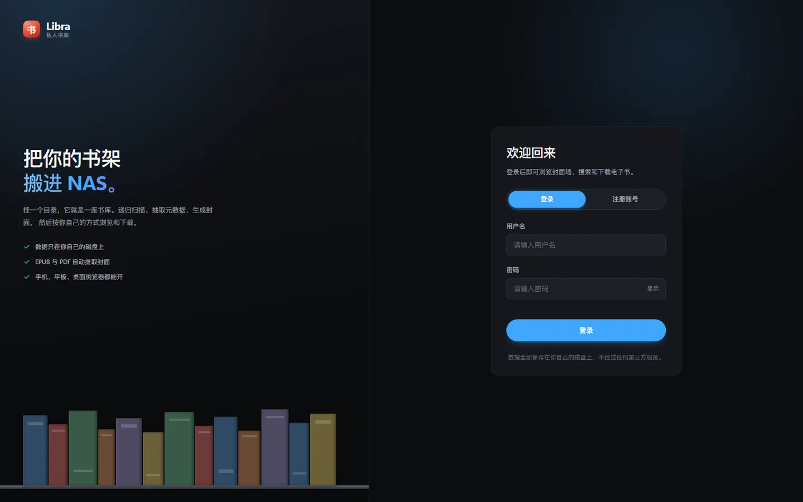
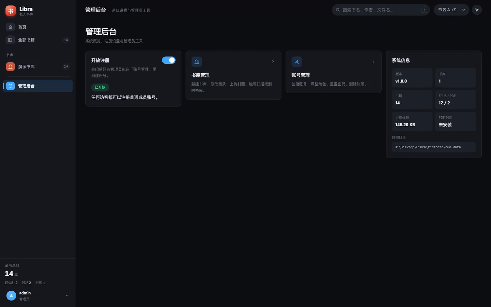
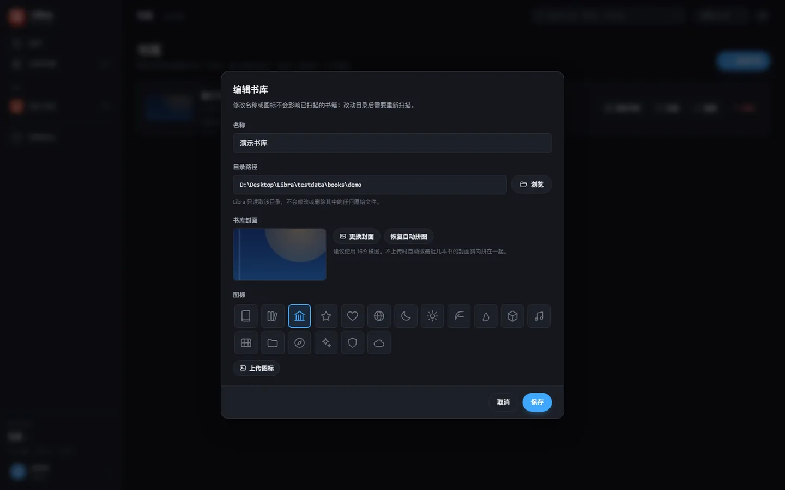

# Libra · 轻量电子书管理系统

> 运行在 NAS 上的自托管电子书库。挂载目录 → 自动扫描 EPUB / PDF → 提取元数据与封面 → 封面墙浏览 → 在线阅读信息 / 下载原文件。

单二进制 + 单 SQLite 文件，零外部服务依赖；前端零构建、零 CDN，断网也能正常使用。


## 功能

- **书库**：任意多个书库，每个库对应一个本地目录；独立扫描、独立统计、独立图标。
- **封面缩略图**：封面墙 / 首页横排 / 轮播缩略图统一走 `/thumbs/`，首次访问生成 400px 缓存，避免每张卡片都下载原图。
- **书库封面**：管理员可在「编辑书库」里上传自定义封面；不上传时自动取该库最近几本书的封面，斜向叠放生成一张拼贴封面。
- **首页**：精选轮播（统一 `cover` + 高斯模糊 + 暗色遮罩）、书库入口卡、各库最新入库横排。
- **浏览**：封面墙 / 搜索 / EPUB·PDF 筛选 / 按书名、作者、入库时间、体积排序 / 三档网格密度 / 滚动到底自动续页。
- **详情与下载**：封面、作者、格式、体积、所属库、入库时间、原始文件名；流式下载，支持 Range 断点续传与中文文件名。
- **账号与权限**：管理员 / 普通成员两级角色；首个注册账号自动成为管理员。
- **管理后台**：`#/admin` 集中放注册开关、书库管理、账号管理和系统信息；普通成员不显示入口。
- **登录 / 注册**：登录页支持显示密码、注册状态提示；管理员可随时在后台开放或关闭注册。
- **体验**：深色 / 浅色主题、侧栏抽屉、快捷键 `/` 聚焦搜索、响应式布局。
- **版本**：当前版本 `1.0.0`，统一从 `main.go` 的 `var version` 读取。

| 深色 | 浅色 |
|---|---|
|  |  |

### 登录与注册

登录页支持显示密码；管理员在后台关闭注册后，登录页会隐藏注册入口并给出提示。



### 管理后台

管理员在 `#/admin` 集中管理注册开关、书库、账号和系统信息。



### 管理员上传书库封面

进入「管理后台」→「书库管理」→ 对应库的「编辑」→「书库封面」。支持上传 / 更换 / 恢复自动拼图，建议使用 16:9 横图。



---

## 快速开始

### 方式 A：Docker Compose（推荐）

```bash
git clone https://github.com/<owner>/libra.git
cd libra

# 首次运行前创建数据目录，并让容器内的 libra 用户（UID 1000）可写
mkdir -p data
sudo chown -R 1000:1000 data

# 修改 docker-compose.yml 里的书籍目录：
#   - /volume1/books:/books:ro  →  你自己的 NAS 路径

docker compose up -d --build
```

打开 `http://<NAS-IP>:8080`。首次访问会引导创建管理员账号 —— **第一个注册的用户自动成为管理员**，即使 `LIBRA_ALLOW_REGISTER=false` 也允许创建首个账号。

### 方式 B：直接使用 GHCR 镜像

GitHub Actions 会构建 `linux/amd64` 与 `linux/arm64` 双架构镜像并推送到 GHCR：

```bash
# Linux / NAS：先准备可写的数据目录
mkdir -p data
sudo chown -R 1000:1000 data

docker run -d \
  --name libra \
  --restart unless-stopped \
  -p 8080:8080 \
  -v "$PWD/data:/data" \
  -v "/path/to/your/books:/books:ro" \
  -e TZ=Asia/Shanghai \
  -e LIBRA_ALLOW_REGISTER=false \
  ghcr.io/<owner>/libra:latest
```

镜像标签：

| 标签 | 来源 |
|---|---|
| `1.0.0` / `v1.0.0` / `1.0` | `main.go` 里的 `var version` |
| `latest` | `main` 分支手动运行 |
| `main` | `main` 分支手动运行 |
| `sha-xxxxxxx` | 对应 commit |

> 把 `<owner>` 换成你的 GitHub 用户名；如果仓库名不是 `libra`，镜像名也要相应替换。
> 首次使用 GHCR 时，包默认可能是私有的。需要匿名拉取的话，到 GitHub 仓库的 Package 设置里把镜像可见性改为 public。

### 方式 C：NAS 本地导入镜像（离线）

如果已经通过 **Build Image Tarball** 下载了镜像 tar，不需要在 NAS 上访问 GHCR：

```bash
# 1. 上传 tar 到 NAS 后导入
docker load -i libra-linux-amd64.tar

# 2. 确认镜像名，默认是 libra:1.0.0
docker images | grep libra

# 3. 准备数据目录
mkdir -p data
sudo chown -R 1000:1000 data

# 4. 修改 docker-compose.nas.yml 里的书籍路径
#    /volume1/books → 你自己的 NAS 书库目录

# 5. 启动
docker compose -f docker-compose.nas.yml up -d
```

完整的 NAS compose 文件：[docker-compose.nas.yml](docker-compose.nas.yml)。

如果导入的镜像标签不是 `libra:1.0.0`，把 yaml 里的 `image:` 改成对应标签即可。

### 方式 D：本地编译

需要 Go 1.22+：

```bash
go mod download
go build -o libra .

LIBRA_DATA_DIR=./data ./libra
# Windows PowerShell:
# $env:LIBRA_DATA_DIR="./data"; .\libra.exe
```

或者：

```bash
make run                   # 编译并本地启动
make linux-amd64           # Linux x86_64
make linux-arm64           # Linux ARM64
make docker                # 本地 docker build
```

前端资源通过 `go:embed` 打进二进制，发布产物只有一个可执行文件。

---

## 首次使用

1. 打开 `http://<NAS-IP>:8080`，注册第一个账号（自动成为管理员）。
2. 进入「管理后台」→「书库管理」→「新建书库」，选择挂载在 `/books` 下的目录。
3. 保存后会立即触发一次扫描；EPUB 会读取内嵌元数据与封面，PDF 会尝试渲染首页封面。
4. 回到首页即可看到书库入口卡、精选轮播和各库最新入库。
5. 可选：在「编辑书库」里上传自定义封面；不上传则自动拼贴。
6. 在「管理后台」里可以随时开放 / 关闭注册，或进入账号管理创建用户。

PDF 首页渲染依赖容器内的 `poppler-utils`。默认镜像已包含；如果不需要，可在构建时使用 `WITH_POPPLER=0`，PDF 仍可入库和下载，但没有渲染出来的首页封面。

---

## 配置

所有配置都通过环境变量完成：

| 变量 | 默认值 | 说明 |
|---|---|---|
| `LIBRA_ADDR` | `:8080` | 监听地址 |
| `LIBRA_DATA_DIR` | `./data` | 数据根目录（数据库 + 封面 + 图标） |
| `LIBRA_DB_PATH` | `<DATA_DIR>/libra.db` | SQLite 数据库路径 |
| `LIBRA_COVERS_DIR` | `<DATA_DIR>/covers` | 封面目录 |
| `LIBRA_ICONS_DIR` | `<DATA_DIR>/icons` | 上传图标目录 |
| `LIBRA_LIBRARY_ROOT` | 空（不限制） | 允许浏览 / 添加的根目录；容器内通常设为 `/books` |
| `LIBRA_SCAN_CONCURRENCY` | `4` | 扫描时的并行外部进程数（1–32） |
| `LIBRA_COVER_WIDTH` | `600` | PDF 首页渲染宽度（px） |
| `LIBRA_SCAN_ON_START` | `true` | 启动时自动做一次增量扫描 |
| `LIBRA_SESSION_TTL_HOURS` | `720` | 登录会话有效期（小时） |
| `LIBRA_ALLOW_REGISTER` | `true` | 初始注册开关；首个账号始终允许创建。管理员可在「管理后台」运行时覆盖并持久化 |
| `LIBRA_TRUSTED_PROXIES` | 空 | 反向代理地址，用于获取真实客户端 IP |
| `LIBRA_WEB_DIR` | 空 | 开发模式：从磁盘读取 `web/`，修改后刷新即可；生产环境留空 |

### 数据目录

```
<DATA_DIR>/
├── libra.db                  SQLite（WAL 模式）
├── covers/<库ID>/
│   ├── <hash>.jpg            书籍原图封面
│   ├── _library-<时间戳>.jpg 管理员上传的书库封面
│   └── thumbs/               400px 封面缩略图缓存
└── icons/                    管理员上传的图标
```

备份时建议先停止容器再复制整个 `/data`，避免直接拷贝正在写入的 SQLite WAL 文件。

---

## 开发

```bash
# 1. 生成联调样本（可选）
python scripts/gen_samples.py     # 输出 testdata/books：EPUB2 / EPUB3 / PDF
python scripts/gen_demo.py        # 输出 testdata/demo：带封面的示例书库

# 2. 开发模式启动（前端直接读 web/，改完刷新即可）
LIBRA_WEB_DIR=./web go run .
# Windows: $env:LIBRA_WEB_DIR="./web"; go run .

# Windows 一键开发脚本：自动构建、启动、监听前后端改动
powershell -ExecutionPolicy Bypass -File scripts/dev.ps1
```

开发模式使用 `LIBRA_WEB_DIR=web` 时，模板每次请求重新解析、静态资源直接读磁盘；生产环境不设置该变量，使用 `go:embed` 的内嵌资源。

### 目录结构

```
.
├── .github/workflows/
│   ├── docker-image.yml       # 手动触发：读代码版本 → GHCR 镜像 + GitHub Release
│   └── image-tar.yml          # 手动触发：单架构镜像导出 tar 作为 Artifact
├── docs/screenshots/          # README 截图
├── internal/
│   ├── auth/                  # 密码策略、bcrypt、会话令牌
│   ├── config/                # 环境变量
│   ├── httpx/                 # Gin 路由、鉴权、REST handlers
│   │   ├── library_handlers.go
│   │   ├── settings_handlers.go  # 管理员设置（注册开关）
│   │   └── thumb_handlers.go     # 封面缩略图生成与缓存
│   ├── scanner/               # 目录遍历、EPUB / PDF 解析、封面生成
│   └── store/                 # SQLite 迁移与 DAO
│       └── settings.go        # settings 表读写
├── scripts/
│   ├── dev.ps1                # Windows 本地开发启动器
│   ├── gen_demo.py            # 生成带封面的示例书库
│   └── gen_samples.py         # 生成 EPUB / PDF 联调样本
├── web/
│   ├── embed.go               # go:embed 前端资源
│   ├── static/                # app.js / login.js / style.css
│   └── templates/             # app.html / login.html
├── Dockerfile
├── docker-compose.yml
├── docker-compose.nas.yml     # NAS 本地导入镜像的 compose
├── Makefile
├── go.mod / go.sum
├── main.go
└── README.md
```

---

## GitHub Actions 与镜像发布

目前有两个手动工作流：

| 工作流 | 用途 | 产物 |
|---|---|---|
| `.github/workflows/docker-image.yml` | 读取代码版本，构建双架构镜像并创建 Release | GHCR 镜像 + GitHub Release |
| `.github/workflows/image-tar.yml` | 手动选择架构，构建单架构镜像并导出 tar | GitHub Actions Artifact，可下载后上传 NAS |

> GitHub 只识别 `.github/workflows/*.yml` 下的工作流，所以 YAML **必须**放在 `.github/workflows/`，不能放在仓库根目录。
>
> 但 YAML 里的相对路径都以 **仓库根目录** 为基准，而不是以 YAML 文件所在的目录为基准：
>
> - `go-version-file: go.mod` → 仓库根目录的 `go.mod`
> - `context: .` → 仓库根目录
> - `file: ./Dockerfile` → 仓库根目录的 `Dockerfile`

### 工作流一：构建 GHCR 镜像并创建 GitHub Release

工作流文件：`.github/workflows/docker-image.yml`

触发条件：**只有手动触发**（`workflow_dispatch`），push 代码或打标签都不会自动运行。

发布用的版本号只有一个来源：`main.go` 里的

```go
var version = "1.0.0"
```

工作流会先读取这个值，然后用同一个版本号：

1. 推送到 GHCR
2. 创建 / 更新 GitHub Release
3. 编译 Linux amd64 / arm64 二进制并作为 Release 附件上传

手动触发步骤：

1. 打开 GitHub 仓库的 **Actions** 页面
2. 左侧选择 **Docker Image & Release**
3. 点击右上角 **Run workflow**
4. 选择要构建的分支（通常是 `main`）
5. 点击 **Run workflow**

假设 `main.go` 里是 `1.0.0`，运行后会得到：

镜像标签：

```text
1.0.0
v1.0.0
1.0
main
sha-xxxxxxx
latest
```

Release：

```text
Tag: v1.0.0
Assets:
  libra-linux-amd64
  libra-linux-arm64
  SHA256SUMS
```

以后发新版本，只需要：

1. 修改 `main.go` 里的 `var version = "1.1.0"`
2. 提交并推送代码
3. 手动运行一次 **Docker Image & Release**

不需要在 workflow 里再填版本号。

> 如果推送镜像时报权限错误，检查仓库 **Settings → Actions → General → Workflow permissions**，并确认工作流中的 `packages: write` 权限没有组织策略拦截。
>
> 创建 Release 需要 `contents: write`，当前 workflow 已经在 release job 里单独声明。

<details>
<summary>展开查看完整 workflow YAML</summary>

```yaml
name: Docker Image & Release

# GitHub Actions 要求工作流放在 .github/workflows/ 下。
# 工作流里的相对路径（go.mod、Dockerfile、context: .）都以仓库根目录为基准，
# 不是以本文件所在的 .github/workflows/ 目录为基准。
#
# 版本号只有一个来源：main.go 里的 var version = "x.y.z"。
# 手动运行后：
#   1. 构建 linux/amd64 + linux/arm64 镜像并推送到 GHCR
#   2. 用同一个版本号创建 / 更新 GitHub Release，并上传 Linux 二进制

on:
  workflow_dispatch:

permissions:
  contents: read

concurrency:
  group: docker-${{ github.ref }}
  cancel-in-progress: true

jobs:
  version:
    name: Read version from main.go
    runs-on: ubuntu-latest
    timeout-minutes: 5
    outputs:
      version: ${{ steps.read.outputs.version }}
      tag: ${{ steps.read.outputs.tag }}
      major_minor: ${{ steps.read.outputs.major_minor }}

    steps:
      - name: Checkout
        uses: actions/checkout@v4

      - name: Read version
        id: read
        shell: bash
        run: |
          VERSION="$(sed -nE 's/^[[:space:]]*var[[:space:]]+version[[:space:]]*=[[:space:]]*"([^"]+)".*/\1/p' main.go | head -n1)"
          if [ -z "$VERSION" ]; then
            echo "::error::无法从 main.go 读取 var version = \"x.y.z\""
            exit 1
          fi
          TAG="v${VERSION}"
          MAJOR_MINOR="$(printf '%s' "$VERSION" | awk -F. 'NF >= 2 {print $1 "." $2}')"
          {
            echo "version=$VERSION"
            echo "tag=$TAG"
            echo "major_minor=$MAJOR_MINOR"
          } >> "$GITHUB_OUTPUT"
          echo "version=$VERSION tag=$TAG major_minor=$MAJOR_MINOR"

  test:
    name: Go vet & build
    needs: version
    runs-on: ubuntu-latest
    timeout-minutes: 15
    steps:
      - name: Checkout
        uses: actions/checkout@v4

      - name: Set up Go
        uses: actions/setup-go@v5
        with:
          go-version-file: go.mod
          cache: true

      - name: Vet
        run: go vet ./...

      - name: Build
        run: go build ./...

  docker:
    name: Build & push image
    needs: [version, test]
    runs-on: ubuntu-latest
    timeout-minutes: 60
    permissions:
      contents: read
      packages: write

    steps:
      - name: Checkout
        uses: actions/checkout@v4

      # GHCR 的镜像名必须是小写；github.repository 可能保留大小写
      - name: Lowercase image name
        id: image
        run: echo "name=$(echo '${{ github.repository }}' | tr '[:upper:]' '[:lower:]')" >> "$GITHUB_OUTPUT"

      - name: Set up QEMU
        uses: docker/setup-qemu-action@v3

      - name: Set up Buildx
        uses: docker/setup-buildx-action@v3

      - name: Log in to GHCR
        uses: docker/login-action@v3
        with:
          registry: ghcr.io
          username: ${{ github.actor }}
          password: ${{ secrets.GITHUB_TOKEN }}

      - name: Docker metadata
        id: meta
        uses: docker/metadata-action@v5
        with:
          images: ghcr.io/${{ steps.image.outputs.name }}
          tags: |
            type=raw,value=${{ needs.version.outputs.version }}
            type=raw,value=${{ needs.version.outputs.tag }}
            type=raw,value=${{ needs.version.outputs.major_minor }},enable=${{ needs.version.outputs.major_minor != '' }}
            type=ref,event=branch
            type=sha,prefix=sha-
            type=raw,value=latest,enable=${{ github.ref == 'refs/heads/main' || startsWith(github.ref, 'refs/tags/v') }}
          labels: |
            org.opencontainers.image.title=Libra
            org.opencontainers.image.description=Lightweight self-hosted ebook library for NAS
            org.opencontainers.image.version=${{ needs.version.outputs.version }}
            org.opencontainers.image.source=${{ github.server_url }}/${{ github.repository }}

      - name: Build and push
        uses: docker/build-push-action@v6
        with:
          context: .
          file: ./Dockerfile
          platforms: linux/amd64,linux/arm64
          push: true
          tags: ${{ steps.meta.outputs.tags }}
          labels: ${{ steps.meta.outputs.labels }}
          build-args: |
            VERSION=${{ needs.version.outputs.version }}
            WITH_POPPLER=1
          cache-from: type=gha
          cache-to: type=gha,mode=max

  release:
    name: GitHub Release
    needs: [version, test, docker]
    runs-on: ubuntu-latest
    timeout-minutes: 20
    permissions:
      contents: write

    steps:
      - name: Checkout
        uses: actions/checkout@v4

      - name: Set up Go
        uses: actions/setup-go@v5
        with:
          go-version-file: go.mod
          cache: true

      - name: Build Linux binaries
        shell: bash
        env:
          VERSION: ${{ needs.version.outputs.version }}
        run: |
          mkdir -p dist
          CGO_ENABLED=0 GOOS=linux GOARCH=amd64 go build -trimpath \
            -ldflags "-s -w -X main.version=${VERSION}" \
            -o dist/libra-linux-amd64 .
          CGO_ENABLED=0 GOOS=linux GOARCH=arm64 go build -trimpath \
            -ldflags "-s -w -X main.version=${VERSION}" \
            -o dist/libra-linux-arm64 .
          (cd dist && sha256sum libra-linux-amd64 libra-linux-arm64 > SHA256SUMS)
          ls -lh dist

      - name: Create or update GitHub Release
        uses: softprops/action-gh-release@v2
        with:
          tag_name: ${{ needs.version.outputs.tag }}
          name: Libra ${{ needs.version.outputs.tag }}
          generate_release_notes: true
          make_latest: true
          overwrite_files: true
          files: |
            dist/libra-linux-amd64
            dist/libra-linux-arm64
            dist/SHA256SUMS
        env:
          GITHUB_TOKEN: ${{ secrets.GITHUB_TOKEN }}
```

</details>

### 工作流二：构建 tar 并上传为 Artifact

工作流文件：`.github/workflows/image-tar.yml`

适合不想在 NAS 上直接 `docker pull`、而是想从 GitHub 网页下载镜像 tar 再上传的场景。

手动触发步骤：

1. 打开 **Actions → Build Image Tarball**
2. 点击 **Run workflow**
3. 选择参数：
   - `arch`：`amd64` 或 `arm64`（按 NAS CPU 选择）
   - `version`：镜像标签，例如 `dev`、`1.0.0`
   - `with_poppler`：`1` 包含 PDF 封面渲染，`0` 更小
4. 运行完成后，在运行页底部 **Artifacts** 下载：
   ```text
   libra-linux-amd64-1.0.0.zip
   ```
5. 解压得到：
   ```text
   libra-linux-amd64.tar
   ```
6. 上传到 NAS 后导入：
   ```bash
   docker load -i libra-linux-amd64.tar
   docker images | grep libra
   ```
7. 启动：
   ```bash
   docker run -d \
     --name libra \
     --restart unless-stopped \
     -p 8080:8080 \
     -v /volume1/docker/libra/data:/data \
     -v /volume1/books:/books:ro \
     -e LIBRA_DATA_DIR=/data \
     -e LIBRA_LIBRARY_ROOT=/books \
     -e LIBRA_ALLOW_REGISTER=false \
     libra:1.0.0
   ```

> `docker save` / tar 只包含一个架构。给 ARM NAS 下载时必须选 `arm64`；给 x86 NAS 选 `amd64`。
>
> 如果 `version` 填的不是 `1.0.0`，启动命令最后的镜像名要相应改成 `libra:<version>`。
>
> GitHub Actions 的 Artifact 默认保留 7 天，过期后需要重新运行工作流。

<details>
<summary>展开查看 image-tar.yml 完整内容</summary>

```yaml
name: Build Image Tarball

# 手动构建单个架构的镜像，并导出为 docker load 可用的 tar。
# 适用于：不想在 NAS 上直接 docker pull，而是从 GitHub Actions 下载 tar 再上传到 NAS。

on:
  workflow_dispatch:
    inputs:
      arch:
        description: "目标架构（按 NAS CPU 选择）"
        required: true
        default: amd64
        type: choice
        options:
          - amd64
          - arm64
      version:
        description: "镜像标签 / 版本号，例如 1.0.0、dev"
        required: true
        default: "1.0.0"
        type: string
      with_poppler:
        description: "是否包含 poppler（PDF 首页封面渲染）"
        required: true
        default: "1"
        type: choice
        options:
          - "1"
          - "0"

permissions:
  contents: read

jobs:
  tarball:
    name: Build linux/${{ inputs.arch }} tar
    runs-on: ubuntu-latest
    timeout-minutes: 60

    steps:
      - name: Checkout
        uses: actions/checkout@v4

      - name: Set up QEMU
        uses: docker/setup-qemu-action@v3

      - name: Set up Buildx
        uses: docker/setup-buildx-action@v3

      - name: Build image tarball
        uses: docker/build-push-action@v6
        with:
          context: .
          file: ./Dockerfile
          platforms: linux/${{ inputs.arch }}
          tags: libra:${{ inputs.version }}
          # type=docker 会生成可以直接 docker load 的 tar；只支持单架构
          outputs: type=docker,dest=libra-linux-${{ inputs.arch }}.tar
          # 离线 tar 不需要 provenance / SBOM，关掉可避免额外清单
          provenance: false
          sbom: false
          build-args: |
            VERSION=${{ inputs.version }}
            WITH_POPPLER=${{ inputs.with_poppler }}
          cache-from: type=gha
          cache-to: type=gha,mode=max

      - name: Show tarball
        run: ls -lh libra-linux-*.tar

      - name: Upload tarball
        uses: actions/upload-artifact@v4
        with:
          name: libra-linux-${{ inputs.arch }}-${{ inputs.version }}
          path: libra-linux-${{ inputs.arch }}.tar
          if-no-files-found: error
          retention-days: 7
```

</details>

---

## HTTP API 摘要

除 `/healthz`、`/login`、`/api/auth/*` 的部分接口外，其余接口均需要登录。响应统一为：

```json
{ "ok": true, "data": { } }
```

出错时为：

```json
{ "ok": false, "error": "错误信息" }
```

| 权限 | 方法 | 路径 | 说明 |
|---|---|---|---|
| 公开 | GET | `/healthz` | 健康检查 |
| 公开 | GET | `/login` | 登录 / 注册页 |
| 公开 | POST | `/api/auth/login` | 登录 |
| 公开 | POST | `/api/auth/register` | 注册（首个用户成为管理员） |
| 公开 | GET | `/api/auth/me` | 登录状态与初始化状态 |
| 登录 | POST | `/api/auth/logout` | 退出 |
| 登录 | POST | `/api/auth/password` | 修改自己的密码 |
| 登录 | GET | `/api/libraries` | 书库列表 |
| 登录 | GET | `/api/libraries/:id` | 单个书库 |
| 登录 | GET | `/api/libraries/:id/scan` | 扫描进度快照 |
| 登录 | GET | `/api/books` | 书籍分页列表 |
| 登录 | GET | `/api/featured` | 首页精选轮播 |
| 登录 | GET | `/api/books/:id` | 书籍详情 |
| 登录 | GET | `/download/:id` | 下载原文件 |
| 登录 | GET | `/covers/*` | 书籍封面 / 书库封面原图 |
| 登录 | GET | `/thumbs/*` | 400px 封面缩略图（按需生成并缓存） |
| 登录 | GET | `/api/status` | 系统概览（版本、统计、数据目录） |
| 管理员 | GET | `/api/admin/settings` | 读取注册开关 |
| 管理员 | PUT | `/api/admin/settings` | 修改注册开关 |
| 管理员 | POST | `/api/libraries` | 新建书库（自动扫描） |
| 管理员 | PUT | `/api/libraries/:id` | 修改名称 / 目录 / 图标 |
| 管理员 | DELETE | `/api/libraries/:id` | 删除书库 |
| 管理员 | POST | `/api/libraries/:id/scan` | 触发扫描 |
| 管理员 | POST | `/api/libraries/:id/cover` | 上传书库封面 |
| 管理员 | DELETE | `/api/libraries/:id/cover` | 恢复自动拼图 |
| 管理员 | GET | `/api/browse` | 浏览服务器目录 |
| 管理员 | POST | `/api/icons` | 上传图标 |
| 管理员 | GET/POST/PUT/DELETE | `/api/users...` | 账号管理 |

---

## 安全说明

- 密码使用 **bcrypt（cost 12）** 哈希；密码长度至少 8 位，拒绝常见弱口令。
- 会话令牌为 32 字节 CSPRNG 随机值；数据库只存 **SHA-256 摘要**，不存原文。
- Cookie 使用 `HttpOnly` + `SameSite=Lax`；反向代理自动切换 `Secure`。
- 登录失败限流：同一 IP + 用户名 5 分钟内 8 次失败即锁定。
- 所有管理接口由后端 `adminOnly` 中间件拦截，前端隐藏入口只是体验优化。
- 响应头 CSP 只允许同源脚本与样式，无任何外部 CDN 依赖。

---

## 常见问题

**PDF 没有封面？**  
容器内缺少 `poppler-utils`，或 PDF 首页是纯矢量图 / 尺寸不达标。启动日志会提示 `未检测到 pdftoppm`。

**书库目录看不到内容？**  
检查 `LIBRA_LIBRARY_ROOT` 与挂载点是否一致。容器默认只允许 `/books` 下的目录。

**上传的书库封面在哪里？**  
在 `<DATA_DIR>/covers/<库ID>/_library-*.jpg`。重新扫描或修改目录不会删除它；删除书库会连同封面目录一起清理。

**忘记管理员密码？**

```bash
docker exec -it libra /usr/local/bin/libra reset-password admin 新密码
```

**数据会不会丢？**  
只要把 `/data` 挂载到宿主机，删除 / 重建容器不会丢数据。书籍目录以只读方式挂载，Libra 不会修改原始文件。

---

## 说明

- 前端使用原生 HTML / CSS / JavaScript，没有构建步骤，也没有任何外部 CDN 依赖。
- EPUB 解析使用标准库 `archive/zip` + `encoding/xml`，不依赖额外 CGO 库。
- 本项目未附带许可证文件；上传到 GitHub 前请根据你的发布意愿补充 `LICENSE`。
